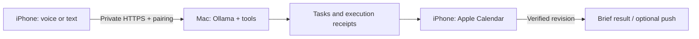

<div align="center">

# PersonalOS
### Your words. Your calendar. Your own AI assistant.

**A local-first AI personal assistant for iPhone and Mac, powered by Ollama.**
Capture tasks, plan around your calendar, and run guarded actions on your Mac.

[](https://github.com/Chauncey665/PersonalOS/actions/workflows/checks.yml)
[](LICENSE)
[](ios)
[](https://ollama.com)

[简体中文](README.zh-CN.md) · [See the demo](#see-it-in-action) · [Quick start](#quick-start) · [iPhone setup](docs/INSTALL.md#4-build-and-sign-your-iphone-app)


</div>

> **Public alpha · self-hosted.** Native SwiftUI interface, currently in Simplified Chinese. English text/voice is supported, with less scheduling-language test coverage. Bring your own Mac, signing identity and private network; there is no shared cloud service or universal iPhone installer.

## A personal assistant for the things you actually need to do

“Finish the report before Friday” should become something you can follow:

**Capture the deadline → find a free slot around classes → sync to Apple Calendar → check it off → reschedule unfinished automatic blocks.**

| Say or type | What PersonalOS can do |
| --- | --- |
| “Finish the report before Friday.” | Save a deadline-only **todo**, without inventing an appointment. |
| “Find time for my tasks.” | Plan around shared calendar events, deadlines, meals and buffers; write execution blocks to **Apple Calendar**. |
| “I haven't finished this today.” | With daily rollover enabled, move unfinished automatic blocks into fresh availability. The deadline stays put. |
| “Find my report and make the ending shorter.” | Search an **authorized directory**, prepare an edit, and require confirmation before writeback. Keep an undo record. |
| “What should I do first today?” | Use available calendar and task context to offer a short suggestion. |
| “Will it rain where I am?” | Use the phone's permitted location and a live weather source; report freshness or failure. |

## See it in action

### Check it off. Watch your day move forward.


Recorded from the **shipping SwiftUI views**, with fictional data in an isolated simulator. The capture harness triggers real EventKit completion saves: **0/5 → 1/5 → 2/5**. This clip covers the progress UI; voice and iCloud are outside its scope. [Demo details and full-size screenshots](docs/DEMO.md).

| Today | Todos & projects | Voice & text |
| --- | --- | --- |
| [](docs/media/today.png) | [](docs/media/todos.png) | [](docs/media/assistant.png) |
| All today's calendar items in one place. | Deadlines, projects and “sometime” tasks. | One sentence to start a task. |

### What connects together

- **iPhone voice assistant:** optional Action Button / Siri Shortcuts entry, saved conversations, brief spoken results and follow-up turns. Microphone access and system handoffs remain subject to iOS permissions.
- **Apple Calendar task planner:** separate planned, deadline and completed calendars; optional automatic rescheduling. A phone write is reported as synced only after its current revision is acknowledged.
- **Mac AI agent:** document search, previews, edit drafts, confirmed writeback and undo. Optional second-Mac access stays read-only.
- **Optional integrations:** Canvas LMS tasks/calendar feeds, location-based weather, HealthKit sharing, training drafts and APNs. Each requires its own setup and consent.

## Quick start

**Start on the Mac. No Apple signing or model download is needed for the first device-status query.**

| You need | For |
| --- | --- |
| Apple Silicon Mac + Python 3.11+ | The self-hosted service. A 32 GB Mac is the reference host; other memory sizes need their own assessment. |
| [Ollama](https://ollama.com/download) + a tool-capable local model | Natural-language reasoning. Initialization does not download weights or enable cloud fallback. |
| Xcode with iOS 26+ SDK + an iPhone | Build and sign the native client yourself. |
| [Tailscale](https://tailscale.com/download) on both devices | Private phone-to-Mac HTTPS connectivity. |

### 1. Run the Mac service

```sh
git clone https://github.com/Chauncey665/PersonalOS.git
cd PersonalOS
python3 -m venv .venv
source .venv/bin/activate
python scripts/personalos.py init
python scripts/personalos.py doctor
python scripts/personalos.py serve
```

In another terminal, from the same project directory:

```sh
.venv/bin/python scripts/personalos.py pair
```

Open **http://127.0.0.1:8765 on that Mac**, enter the short-lived pairing code, and submit `设备状态`. You should receive real platform and disk information. [Port already in use?](docs/INSTALL.md#2-test-on-the-mac)

### 2. Enable local reasoning

With Ollama running, explicitly install the configured model:

```sh
ollama pull qwen3.5:9b
```

`doctor` checks the exact installed tag at `127.0.0.1:11434`. You can configure another tool-capable local model; do not rename shared aliases. [Model configuration and installation](docs/INSTALL.md#1-requirements-and-source).

### 3. Connect your iPhone

[**Follow the illustrated setup path →**](docs/SETUP.md)

**Private Tailscale URL → your Xcode team & bundle ID → build to iPhone → pair → grant Calendar access → verify a real event.**

The [full installation guide](docs/INSTALL.md) includes commands, signing boundaries and checks. [Voice setup](docs/VOICE.md) is a separate optional step; the base install does not download ASR/TTS models. HealthKit, APNs and Canvas are optional too.

## Your assistant, your name

**PersonalOS is the project name. Your assistant's name is your choice.** After setup:

```sh
python scripts/personalos.py name Atlas
```

Restart the service before a new conversation. Chinese names are supported. The private `assistant-profile.json` stores the name; it grants no extra permissions. To change the Home Screen label, edit `CFBundleDisplayName` in Xcode and rebuild. Keep the workflow bundle ID consistent.

## Local first, with receipts

Your Mac runs the model and stores tasks in SQLite. The iPhone owns EventKit writes. Local files stay within authorized tool scope; file changes require a current preview and confirmation. Optional network tools contact their configured providers. There is no automatic cloud-model fallback.



Designed for **one person and trusted paired devices**. Keep the service private; do not enable Funnel or public port forwarding. PersonalOS does not bypass the iOS sandbox. See [SECURITY.md](SECURITY.md).

<details>
<summary><strong>Current limits and verification</strong></summary>

- Speech and natural-language dates can still be wrong; review Calendar. iOS may require opening the App for a fresh snapshot or pending writes. An offline phone is not a completed sync.
- Navigation, sharing, microphone use and lock-screen behavior depend on system UI. Personal WeChat messages are not sent automatically.
- The routine starts at 11:00–next-day 01:00, with two 45-minute meals, 15-minute class buffers and a four-hour daily task budget. Change these through planning settings; the App does not yet contain a complete routine editor.
- Canvas requires your institution's configured HTTPS origin. A calendar feed cannot prove assignment submission. Public-holiday queries currently cover Hong Kong. Training suggestions are drafts based on shared data.
- CI covers backend checks, an isolated install smoke and unsigned iOS Simulator compilation. That is distinct from a new user's Apple signing, physical phone permissions or provider-account acceptance. [Verification scope](docs/VERIFICATION.md).

</details>

## Build with us

Try one task on your own devices and tell us what worked. [Report a reproducible issue](https://github.com/Chauncey665/PersonalOS/issues/new) or read [CONTRIBUTING.md](CONTRIBUTING.md). Use fictional data; never post health exports, calendar feeds, credentials or databases.

```sh
python scripts/check_release.py
python -m unittest discover -s tests
python -m unittest discover -s air
python scripts/smoke_install.py
```

The historical real-Ollama integration scenario is opt-in via `PERSONALOS_LIVE_TESTS=1`. [Architecture](docs/ARCHITECTURE.md) · [Integrations](docs/INTEGRATIONS.md) · [Voice](docs/VOICE.md) · [Verification](docs/VERIFICATION.md).

**Want a personal AI assistant on your own devices? Star PersonalOS to follow its progress.**

[MIT](LICENSE) for project source. Models and optional dependencies have their own terms and are not bundled. [Third-party notes](THIRD_PARTY_NOTICES.md).
