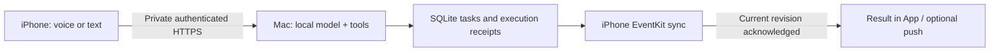

<div align="center">

# PersonalOS
### Turn what you say into a plan you can actually follow.

**A local-first personal assistant for iPhone + your Mac.**

[简体中文](README.zh-CN.md) · [Install](docs/INSTALL.md) · [安装教程](docs/INSTALL.zh-CN.md) · [Voice](docs/VOICE.md) · [Security](SECURITY.md)

</div>

> Public alpha. A working personal project being made reproducible, not an App Store release or a promise of autonomous control over every app. The current interface is primarily Simplified Chinese. English voice/text is supported, but English scheduling language has less test coverage.

“Finish the report before Friday.” → capture the deadline → find time around classes → write an execution block to Apple Calendar → move unfinished work the next day → report the actual changes.

## Choose your assistant’s name

**PersonalOS is the project name. Your assistant’s name is your choice.** For example, call yours Atlas:

```sh
python scripts/personalos.py name Atlas
```

Restart the Mac service before a new conversation. The name is stored in your private `assistant-profile.json` and does not grant permissions. Chinese names are supported. To change the Home Screen label as well, edit `CFBundleDisplayName` in Xcode before building; keep the workflow bundle ID consistent.

## What it does

- **Voice or text → tasks and schedules.** A deadline-only request becomes a todo; an explicit start/end becomes an event. Projects can have subtasks and independent due dates.
- **Plan around real availability.** Use phone-shared calendar events, task deadlines, meals and buffers. Opt-in daily rollover moves unfinished automatic blocks without moving their deadlines.
- **Apple Calendar integration.** Separate calendars for planned work, deadlines and completed items. Completion is an explicit checkmark. A server task finishing is not proof of an EventKit write.
- **A private Mac executor.** Authorized document search, file previews, edits and guarded writeback/undo; an optional second Mac remains read-only.
- **Short conversations with actual receipts.** Persisted sessions and multi-step workflows; on-demand tool descriptions; scoped history; bounded no-progress handling; brief speech rather than reading an entire report.
- **Optional connections.** Read-only Canvas API/calendar feed, phone-location weather, HealthKit sharing, training drafts and APNs. Hong Kong public holidays are currently a region-specific connector. Other regions are not silently inferred.



## Try the smallest real loop first

On an Apple Silicon Mac with Python 3.11+ and [Ollama](https://ollama.com/download) installed:

```sh
git clone https://github.com/Chauncey665/PersonalOS.git
cd PersonalOS
python3 -m venv .venv
source .venv/bin/activate
python scripts/personalos.py init
python scripts/personalos.py doctor
python scripts/personalos.py serve
```

In another terminal, activate the same environment and run:

```sh
python scripts/personalos.py pair
```

Open `http://127.0.0.1:8765` **on that Mac**, enter the short-lived code, and submit `设备状态`. This uses real local device information and works without a language model. To enable natural-language planning, explicitly download the configured model:

```sh
ollama pull qwen3.5:9b
```

The default assumes Ollama is running at `127.0.0.1:11434`. `doctor` checks whether the configured tag exists; initialization does not download anything. The [Ollama model page](https://ollama.com/library/qwen3.5) documents available sizes. A 32 GB Apple Silicon Mac is the reference machine; smaller machines need their own memory/latency assessment.

**Next:** follow the [installation guide](docs/INSTALL.md) to connect your iPhone through Tailscale, build/sign the SwiftUI app, and verify an actual calendar receipt. Use your own Apple account, bundle ID and private server address.

## Components and boundaries

| Component | Requirements / behavior |
| --- | --- |
| Core service | Python standard library + SQLite; binds only to IPv4 loopback |
| Local reasoning | An already installed tool-capable Ollama model; configurable tag, context and residency; no automatic cloud fallback |
| iPhone app | Full Xcode with iOS 26+ SDK to compile current App Intents; iOS 26+ recommended for current voice flows. The project retains an older deployment target, which is not an acceptance claim for all older phones |
| Calendar | User grants EventKit access on their phone; background execution is limited by iOS |
| Voice recognition | Optional Apple Silicon MLX setup and a separately downloaded model; explicit install only |
| Speech playback | System speech by default; optional local Qwen TTS / Uncle_Fu |
| APNs / HealthKit | Separate signing capabilities, account conditions and user permissions; omitted from the base entitlement file |
| Canvas | Locally configure your institution's HTTPS origin first; only that origin is accepted; a feed does not prove assignment submission |
| Remote Mac | Advanced, optional forced-command SSH setup with pinned host keys; no general SSH shell granted to the model |

This is intended for **one person and their trusted paired devices**, not as an internet-facing or multi-tenant service. See [SECURITY.md](SECURITY.md).

## Development

```sh
python scripts/check_release.py
python -m unittest discover -s tests
python -m unittest discover -s air
python scripts/smoke_install.py
```

The default suite uses isolated state and does not require downloading a model. The historical real-Ollama integration scenario is opt-in via `ELLIS_LIVE_TESTS=1`. The clean install smoke starts a separate loopback server, pairs two synthetic devices, verifies owner isolation, executes a real device-status request, and cleans up.

For iOS:

```sh
xcodebuild -project ios/PersonalOS.xcodeproj -scheme PersonalOS \
  -sdk iphonesimulator -destination 'generic/platform=iOS Simulator' \
  -derivedDataPath build CODE_SIGNING_ALLOWED=NO build
```

GitHub Actions is included for backend checks and an unsigned Simulator build. Its remote execution is not claimed until the repository is published and Actions runs.

## Project layout

- `server/`: authenticated API, local tool loop, calendar/todo logic, persistence and optional connectors.
- `ios/`: SwiftUI app, EventKit, HealthKit integration, phone actions and App Intents.
- `scripts/`: explicit setup, diagnosis, smoke checks and shortcut generation.
- `shortcuts/`: unsigned XML workflow sources, using a generic bundle ID; no signing certificates.
- `config/examples/`: disabled or placeholder configurations; copy privately and adapt them.
- `air/`: optional restricted exporters and tests; no pretrusted host key.

## Current limitations

Natural-language and speech recognition can still be wrong; dates should be checked in Calendar. File writes require a current preview and confirmation. Navigation, sharing, microphone access and lock-screen behavior remain subject to system UI and permission prompts. The assistant does not bypass the iOS sandbox or send personal WeChat messages automatically. Training is a draft based on shared data, not a diagnosis or a measured fitness assessment.

Fresh calendar context may require opening PersonalOS. An offline phone cannot be treated as having already written the new plan. Source, tests and an unsigned build are distinct from a new user's signing, hardware and account verification; see [VERIFICATION.md](docs/VERIFICATION.md).

## Contributing and license

Small, reproducible changes are welcome. Start with [CONTRIBUTING.md](CONTRIBUTING.md), use synthetic data, and include evidence of the behavior you changed. Never attach health exports, calendar feeds, database files or credentials to an issue.

PersonalOS source is released under [MIT](LICENSE). Models, Apple SDKs and optional dependencies have their own terms and are not bundled. [Third-party notes](THIRD_PARTY_NOTICES.md) include the projects whose designs informed the implementation.
