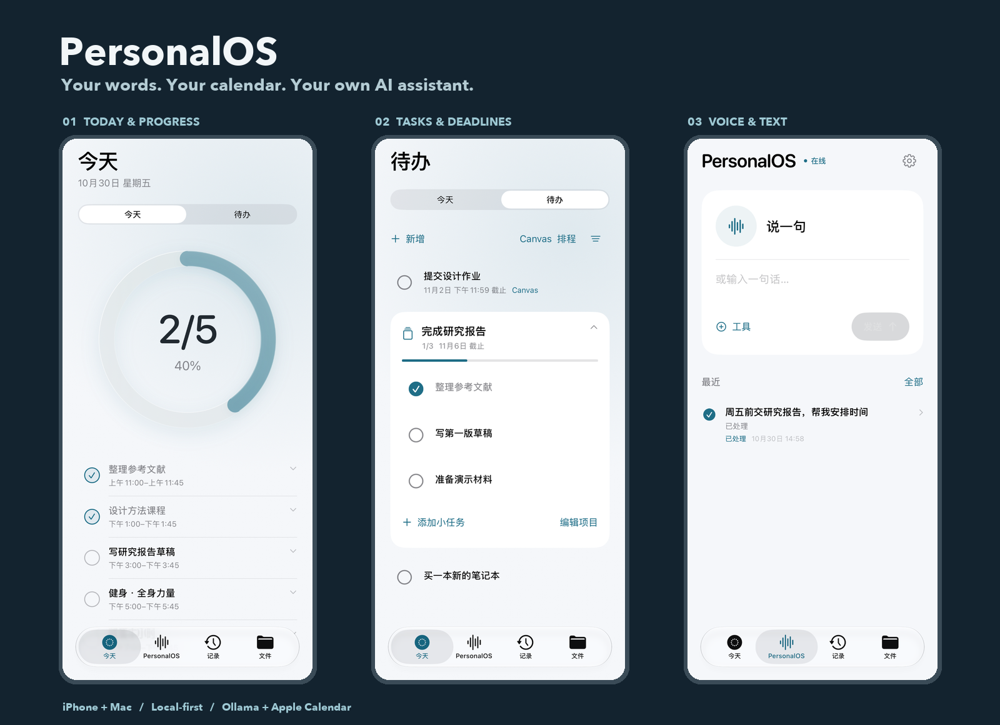
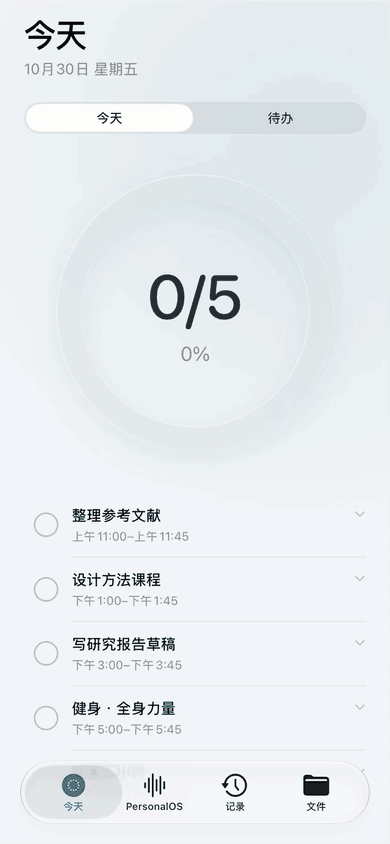
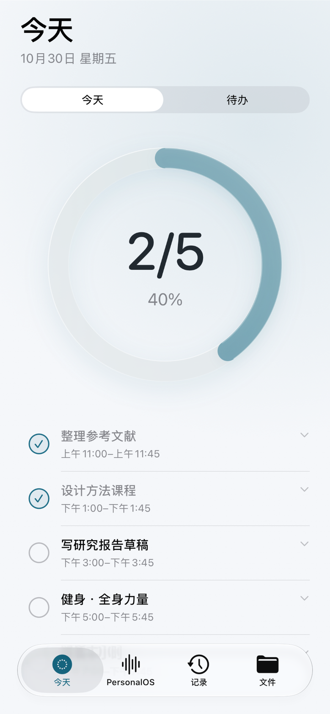
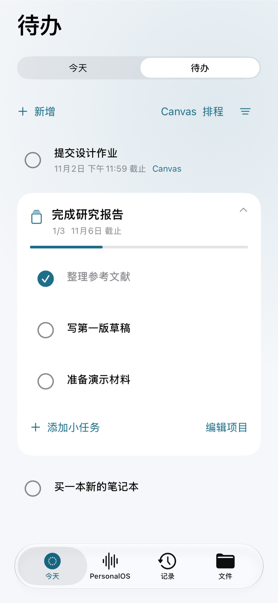
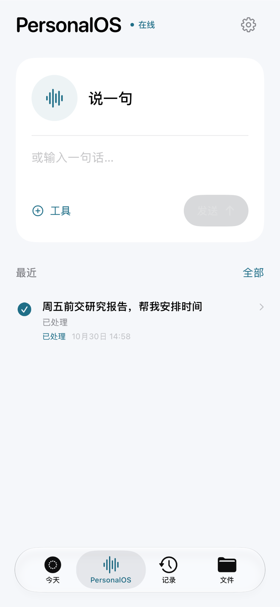
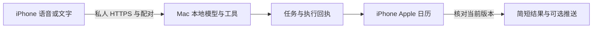

<div align="center">

# PersonalOS
### 把一句话，变成待办、日程和真正的操作。

**面向 iPhone 和 Mac 的本地 AI 私人助手，使用 Ollama 运行本地模型。**
记住要做的事，按空档排进 Apple 日历，让 Mac 处理授权范围内的文件。

[](https://github.com/Chauncey665/PersonalOS/actions/workflows/checks.yml)
[](LICENSE)
[](ios)
[](https://ollama.com)

[English](README.md) · [看演示](#先看它怎么用) · [开始安装](#先在-mac-跑起来) · [iPhone 设置](docs/INSTALL.zh-CN.md)



</div>

> **公开 Alpha，自行部署。** 当前原生 SwiftUI 界面以简体中文为主，支持中英文输入和语音，英文排程表达的测试覆盖较少。需要自己的 Mac、Apple 签名和私有网络；没有共享服务器，也没有人人通用的 iPhone 安装包。

## 一个了解你今天要做什么的私人助手

“周五前交报告。”说完之后，事情应该有个落点：

**记下截止日期 → 避开课程找空档 → 安排到 Apple 日历 → 完成后打勾 → 没做完的自动重排。**

| 你说的话 | PersonalOS 可以做什么 |
| --- | --- |
| “周五前交报告。” | 记成只有截止日期的**待办**，不凭空造一个起止日程。 |
| “给这些待办安排时间。” | 结合共享日历、截止日期、吃饭和缓冲时间，把执行时段写入 **Apple 日历**。 |
| “今天这项没做完。” | 开启每日顺延后，根据新空档重排未完成的自动时段；截止日期保持原样。 |
| “找到我的报告，把结尾改简洁一点。” | 在**授权目录**检索，生成修改稿，确认后写回，保留撤销记录。 |
| “今天应该先做什么？” | 根据可用的课表、任务和截止信息，给出简短建议。 |
| “我这里今天会下雨吗？” | 使用手机授权的位置查询实时天气，说明新鲜度或失败原因。 |

## 先看它怎么用

### 完成一项，今天就往前走一点。



来自**正式版 SwiftUI 界面**，使用独立模拟器与虚构数据。录制程序触发真实 EventKit 完成操作，展示 **0/5 → 1/5 → 2/5**；这段只验证进度界面，不包含语音和 iCloud 链路。[演示说明与原图](docs/DEMO.md)。

| 今天 | 待办与项目 | 语音与文字 |
| --- | --- | --- |
| [](docs/media/today.png) | [](docs/media/todos.png) | [](docs/media/assistant.png) |
| 一眼看到全部日历事项与完成进度。 | 有截止的、没定时间的、大项目都能记。 | 说一句或写一句，开始处理。 |

### 接起来能做什么

- **iPhone 语音私人管家：**可选 Action Button / Siri 快捷指令入口，保存会话、简短播报、连续追问。录音和系统跳转仍受 iOS 权限限制。
- **Apple 日历智能排程：**计划、截止、已完成分类显示，可开启自动重排。只有收到手机对当前版本的写入回执，才报告已同步。
- **Mac 本地 AI Agent：**检索和预览文档、准备修改稿、确认写回、撤销。可选第二台 Mac 保持只读访问。
- **可选连接：**Canvas LMS 待办／日历订阅、定位天气、HealthKit、训练草案和 APNs 推送，按需单独配置与授权。

## 先在 Mac 跑起来

**第一步只查询设备状态，不需要 Apple 签名，也不需要先下载模型。**

| 准备什么 | 用来做什么 |
| --- | --- |
| Apple Silicon Mac、Python 3.11+ | 常驻私人服务。32GB Mac 是参考设备，其他内存配置需自行验证。 |
| [Ollama](https://ollama.com/download) 和支持工具调用的本地模型 | 自然语言理解。初始化不会自动下载模型或开启云端回退。 |
| 带 iOS 26+ SDK 的完整 Xcode、iPhone | 自行签名和构建原生客户端。 |
| 两台设备上的 [Tailscale](https://tailscale.com/download) | 手机和 Mac 的私人 HTTPS 连接。 |

### 1. 启动 Mac 服务

```sh
git clone https://github.com/Chauncey665/PersonalOS.git
cd PersonalOS
python3 -m venv .venv
source .venv/bin/activate
python scripts/personalos.py init
python scripts/personalos.py doctor
python scripts/personalos.py serve
```

另开终端，进入同一个项目目录：

```sh
.venv/bin/python scripts/personalos.py pair
```

在**这台 Mac** 打开 **http://127.0.0.1:8765**，输入本机显示的短期配对码，提交“设备状态”。应能看到真实系统和磁盘信息。端口占用的处理方法见[安装教程](docs/INSTALL.zh-CN.md)。

### 2. 开启本地理解

保持 Ollama 运行，显式下载已配置的模型：

```sh
ollama pull qwen3.5:9b
```

`doctor` 会在 `127.0.0.1:11434` 核对完整标签。可以配置其他支持工具调用的模型；不要覆盖共享模型别名。详细步骤见[模型与环境设置](docs/INSTALL.zh-CN.md)。

### 3. 接上 iPhone

[**按图走完安装路径 →**](docs/SETUP.md)

**取得自己的 Tailscale 私人网址 → 选择 Xcode 团队与 Bundle ID → 构建到手机 → 配对 → 授权日历 → 验证一条真实日程。**

[完整中文教程](docs/INSTALL.zh-CN.md)包含命令、签名要求和验收方法。[语音入口](docs/VOICE.md)需要单独配置，基础安装不下载识别或播报模型。健康、推送和 Canvas 也都是可选项。

## 助手叫什么，由你决定

**PersonalOS 是项目名，助手名字可以由每位用户自己修改。** 完成基础安装后，例如：

```sh
python scripts/personalos.py name Atlas
```

也支持中文名字。重启 Mac 服务后开始新对话即可生效。称呼保存在自己的私有 `assistant-profile.json`，不会改变权限。手机桌面名称可在 Xcode 修改 `CFBundleDisplayName` 后重新构建，快捷指令使用一致的 Bundle ID。

## 本地优先，完成要有回执

Mac 运行模型，用 SQLite 保存任务；iPhone 负责 EventKit 写入。文件工具在授权范围内工作，改动前需要当前版本预览和确认。可选联网工具访问各自配置的数据来源，不会自动把推理切到云端模型。



面向**一个人与其可信设备**。保持私人连接，不开启 Funnel 或公网端口转发，不绕过 iOS 沙盒。[安全说明](SECURITY.md)。

<details>
<summary><strong>当前限制与验证范围</strong></summary>

- 语音、自然语言和日期识别仍可能出错，请检查日历。新鲜课表或待写日程有时需要打开 App；手机离线不能当成已同步。
- 导航、分享、录音和锁屏行为受系统界面限制，不会自动发送微信个人号消息。
- 初始作息为 11:00 至次日 01:00，午晚餐各45分钟、课程缓冲15分钟，每日待办预算4小时。排程设置接口允许调整，手机端尚无完整作息编辑器。
- Canvas 先配置学校 HTTPS 来源；订阅无法判断作业是否已提交。目前公众假期查询覆盖香港。训练建议是基于共享数据的草案。
- CI 检查后端、独立目录安装和无签名模拟器构建；新用户的 Apple 签名、手机权限、第三方账号仍需本人验收。[验证范围](docs/VERIFICATION.md)。

</details>

## 一起把它做得更好用

欢迎先在自己的设备跑通一个任务，再[反馈可复现的问题](https://github.com/Chauncey665/PersonalOS/issues/new)。参与方式见 [CONTRIBUTING.md](CONTRIBUTING.md)。请使用虚构数据，不上传健康导出、日历订阅、凭据或数据库。

```sh
python scripts/check_release.py
python -m unittest discover -s tests
python -m unittest discover -s air
python scripts/smoke_install.py
```

真实 Ollama 的旧集成用例默认跳过，可显式设 `PERSONALOS_LIVE_TESTS=1`。[架构](docs/ARCHITECTURE.md) · [集成](docs/INTEGRATIONS.md) · [语音](docs/VOICE.md) · [验证](docs/VERIFICATION.md)。

**如果你也想要一个自己的 AI 私人管家，欢迎点个 Star，关注 PersonalOS 的进展。**

源码采用 [MIT](LICENSE)，模型和可选依赖分别遵循其许可且未打包。[第三方说明](THIRD_PARTY_NOTICES.md)。
