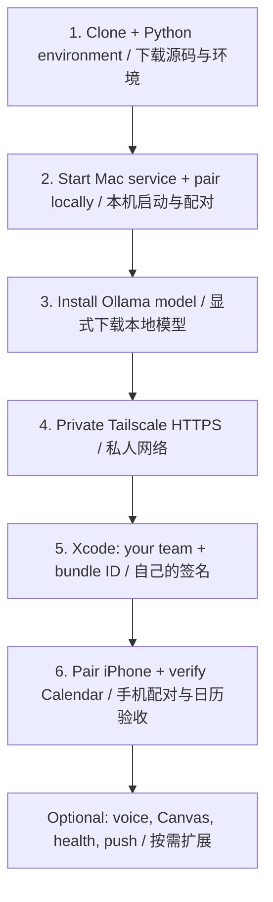

# Installation map / 安装路线图

[English README](../README.md) · [中文 README](../README.zh-CN.md) · [Full English guide](INSTALL.md) · [完整中文教程](INSTALL.zh-CN.md)

Start with one real device-status query on the Mac. Add the phone and optional integrations after that works.
先在 Mac 跑通一次真实设备查询，再接手机和可选功能。

| Step | Do this / 操作 | Check before continuing / 验收 |
| --- | --- | --- |
| **1 · Mac** | Clone the repo, create `.venv`, run `init` and `doctor`. 下载源码、建虚拟环境、初始化。 | A separate private data directory is created. 缺少模型可以先继续设备查询；不要忽略其他错误。 |
| **2 · First result** | Run `serve`, then `pair` in a second terminal. Open `http://127.0.0.1:8765` on the Mac and submit `设备状态`. | A real status result appears. 看到系统与磁盘结果。No Apple signing needed here. |
| **3 · Reasoning** | Start Ollama; explicitly run `ollama pull qwen3.5:9b` or configure another compatible tag. | `doctor` finds the complete model tag. 不是看到下载100%就当安装成功。 |
| **4 · Private network** | Connect Tailscale on Mac and iPhone; configure private Serve. Use the URL from **your own** `serve status`. | iPhone Safari reaches your service. 手机打开自己的私人网址；不启用 Funnel。 |
| **5 · Native App** | Open `ios/PersonalOS.xcodeproj`, select **your** team and a unique bundle ID, build to the phone with Xcode and iOS 26+ SDK. | App opens on your phone. 签名、开发者模式和系统权限由本人确认。 |
| **6 · Calendar** | Pair in the App, grant Calendar access, submit `明天15:00到16:00，安排日历验收`. | Check the title/time in Apple Calendar and return to the App for the receipt. 日历里出现且当前版本回执成功。 |

**Commands and troubleshooting:** [English](INSTALL.md) / [中文](INSTALL.zh-CN.md).

## Add only what you want / 按需增加

| Optional capability | Guide | Requires |
| --- | --- | --- |
| Voice, Action Button, Siri Shortcuts / 语音 | [VOICE.md](VOICE.md) | Separate ASR setup, your signed shortcuts, microphone approval. 单独配置识别模型与快捷指令。 |
| Canvas, weather, second Mac / 集成 | [INTEGRATIONS.md](INTEGRATIONS.md) | Your own configured sources and authorization. 使用自己的来源和账号。 |
| HealthKit and APNs / 健康与推送 | [Installation guide](INSTALL.md) | Separate capabilities, signing and user consent. 不包含在基础签名里。 |
| A personal name / 自定义助手名 | [README](../README.zh-CN.md#助手叫什么由你决定) | `python scripts/personalos.py name Atlas`, then restart. |

Core setup never asks you to paste passwords or private calendar feeds into a public issue. Keep keys and runtime data outside the repository.
不要把密码、密钥、日历订阅或运行数据库贴到公开 Issue。
